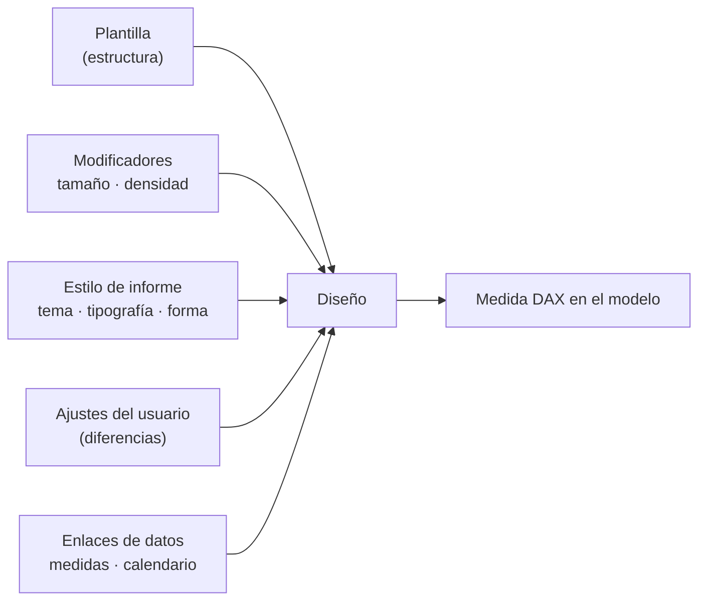
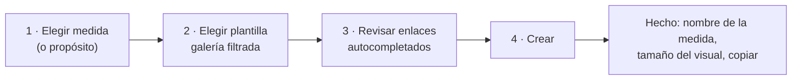
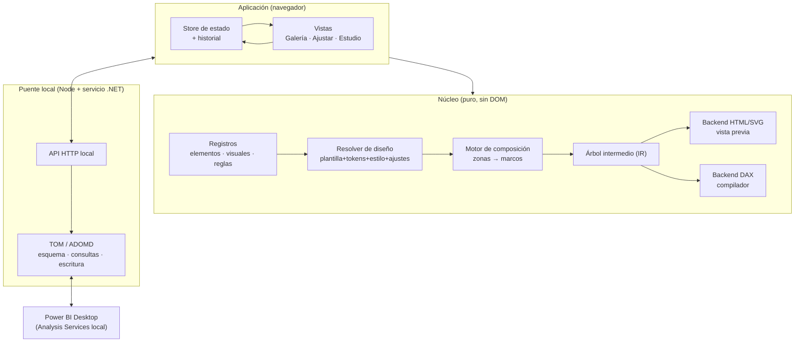

# KPI Atelier v2 · Especificación funcional y técnica

| | |
|---|---|
| **Estado** | Borrador 1 · para revisión |
| **Fecha** | 10/10/2026 |
| **Punto de partida** | v1.4.0 (18 plantillas, 6 familias, 16 elementos, editor de lienzo fijo, generación DAX, puente local con Power BI Desktop) |
| **Alcance** | Rediseño de la experiencia, la biblioteca, el motor de composición y la integración con Power BI. No depende de las opciones actuales. |

**Convenciones:** `RF-xx` = requisito funcional · `RT-xx` = requisito técnico · **[MVP]** = imprescindible en la v2.0 · **[v2.x]** = posterior.

---

## 0. Resumen

KPI Atelier pasa de ser «un editor de tarjetas con plantillas» a **un sistema de tarjetas KPI**. Hay tres ideas de fondo:

1. **Plantilla ≠ variante.** La biblioteca contiene estructuras (≈30). El tamaño, la densidad y el estilo son modificadores que se aplican al momento. Así se evita la explosión combinatoria.
2. **Un mismo diseño, tres niveles de profundidad.** *Rápido* (30–60 s) → *Ajustar* (2–5 min) → *Estudio* (pixel perfect). Se trabaja siempre sobre el mismo objeto, sin perder nada al cambiar de nivel.
3. **Power BI en el centro.** Se leen las medidas del modelo, se sugieren automáticamente, la vista previa usa datos reales y la medida se crea, actualiza o reabre desde el modelo.

---

# PARTE A · ESPECIFICACIÓN FUNCIONAL

## 1. Principios de producto

| # | Principio | Consecuencia en el diseño |
|---|---|---|
| P1 | **El camino rápido es el camino por defecto** | Toda pantalla tiene una acción principal evidente. Nada obliga a configurar. |
| P2 | **Revelación progresiva** | Una opción solo aparece cuando tiene sentido (hay dependencias) y en el nivel que corresponde. |
| P3 | **Imposible hacerlo feo** | Los valores por defecto, la escala de tipografía y los espaciados vienen de *tokens* de diseño. Las combinaciones inválidas no se pueden seleccionar. |
| P4 | **Nada se pierde** | Deshacer ilimitado por diseño, borrador automático y paso libre entre niveles sin perder ajustes. |
| P5 | **Lo que ves es lo que obtienes** | La vista previa y Power BI usan el mismo motor. Las dimensiones se expresan en los píxeles reales del visual. |
| P6 | **Útil más allá de una tarjeta** | Creación en lote, estilo de informe compartido y actualización masiva de medidas. |
| P7 | **Premium = rápido y cuidado** | Respuesta inmediata (< 100 ms), microinteracciones sobrias, textos claros y estados vacíos o de error con salida. |

## 2. Usuarios y métricas de éxito

### 2.1 Perfiles

| Perfil | Necesidad | Nivel principal | Qué lo hace feliz |
|---|---|---|---|
| **Ágil** (analista con prisa, consultor) | Tener tarjetas bonitas y coherentes ya | Rápido | «En un minuto tenía 4 KPI en el informe». |
| **Perfeccionista** (diseñador de informes, equipo de BI de marca) | Control total de cada píxel y coherencia con la marca | Ajustar + Estudio | «Es exactamente como lo diseñé, y lo puedo reutilizar». |
| **Mantenedor** (quien hereda el informe) | Cambiar el estilo o corregir medidas sin rehacer nada | Mis diseños + Estilo de informe | «Cambié el color corporativo de 20 tarjetas en un clic». |

### 2.2 Métricas objetivo (verificables)

| Métrica | Objetivo |
|---|---|
| Tiempo desde abrir la app (conectada) hasta crear la medida en el modelo, con una plantilla | **≤ 60 s** (p50 ≤ 40 s) |
| Clics en el flujo rápido | **≤ 5** |
| Tiempo para crear 4 KPI coherentes (lote) | **≤ 90 s** |
| Respuesta de la vista previa tras un cambio | **≤ 100 ms** (deslizadores ≤ 16 ms por fotograma) |
| Carga de la galería | **≤ 1 s**, miniaturas progresivas |
| Medidas generadas que fallan al evaluarse en Power BI | **0 %** dentro de la matriz de pruebas |

## 3. Modelo conceptual



| Concepto | Definición |
|---|---|
| **Plantilla** | Estructura: propósito, disposición, visual principal, elementos activos, zonas y valores por defecto. Es inmutable y está versionada. |
| **Modificador** | Parámetro global que transforma la plantilla sin cambiar su estructura: tamaño (S/M/L/personalizado) y densidad. |
| **Estilo de informe** | Conjunto con nombre de tema, colores semánticos, tipografía, radio, borde y superficie. Se comparte entre tarjetas. |
| **Ajustes** | Diferencias que hace el usuario respecto a la plantilla y el estilo (*overrides*). Se guardan como diferencia, no como copia completa. |
| **Enlaces** | Medidas del modelo asignadas a cada rol (valor, referencia, objetivo, serie) y calendario. |
| **Diseño** | Plantilla + modificadores + estilo + ajustes + enlaces. Es lo que se guarda y se reabre. |
| **Mi plantilla** | Diseño promovido a plantilla reutilizable por el usuario. |

> [!IMPORTANT]
> Como los ajustes se guardan como diferencias, se puede **cambiar el estilo de informe o actualizar la plantilla** y propagarlo a todos los diseños sin perder las personalizaciones.

## 4. Biblioteca y taxonomía

### 4.1 Facetas principales (ordenan y filtran la galería)

**RF-01 [MVP]** Cada plantilla se clasifica con exactamente **un valor** en cada una de estas tres facetas:

| Faceta | Valores | Pregunta que responde |
|---|---|---|
| **Propósito** | `Valor` · `Comparación` · `Objetivo` · `Tendencia` · `Estado` · `Ejecutiva` | ¿Qué quiero comunicar? |
| **Disposición** | `Solo texto` · `Visual abajo` · `Visual a la izquierda` · `Visual a la derecha` · `Visual de fondo` [v2.x] | ¿Dónde va el visual? |
| **Visual principal** | `Ninguno` · `Línea/área` · `Columnas` · `Anillo` · `Barra de progreso` · `Bullet` · `Semáforo` · `Semicírculo` [v2.x] | ¿Con qué se apoya el número? |

### 4.2 Modificadores (no generan plantillas nuevas)

**RF-02 [MVP]** Los modificadores se eligen con selectores (*chips*) sobre la vista previa y se aplican a la plantilla seleccionada y a todas las miniaturas de la galería.

| Modificador | Valores | Regla |
|---|---|---|
| **Tamaño** | `S` (¼ de fila) · `M` (⅓) · `L` (½) · `Personalizado` | Medidas de referencia en §7.1 |
| **Densidad** | `Compacta` · `Estándar` · `Holgada` | Escala espaciados y textos secundarios (§7.2). No cambia la estructura. |
| **Estilo** | Estilos de informe predefinidos y propios | §7.4 |

### 4.3 Etiquetas de contenido (filtros rápidos)

**RF-03 [MVP]** Filtros acumulables «contiene…»: `icono` · `variación` · `objetivo` · `subtítulo` · `etiqueta superior` · `pie/período`. Se calculan automáticamente a partir de los elementos activos de la plantilla.

### 4.4 Matriz de validez

**RF-04 [MVP]** Las combinaciones inválidas no se ofrecen. Si un modificador deja de ser válido, la app aplica el más cercano y lo indica con una nota discreta.

| Regla | Motivo |
|---|---|
| `Izquierda/Derecha` solo en **M, L** | En S no hay ancho útil |
| `S` + `Holgada` no disponible | Densidad visual insuficiente |
| `Ejecutiva` solo en **L** (y M compacta) | Demasiados elementos |
| `Anillo`, `Bullet`, `Barra`, `Semicírculo` exigen el rol **Objetivo** | Sin objetivo no hay avance |
| `Línea/área`, `Columnas` exigen el rol **Serie** (calendario) | Sin serie no hay tendencia |
| `Semáforo` exige **umbrales** | — |

### 4.5 Galería

- **RF-05 [MVP]** Disposición: barra de propósitos (pestañas con icono) → filtros (disposición, visual, etiquetas) → cuadrícula de miniaturas renderizadas con el motor real, el estilo de informe activo y, si hay conexión y medida seleccionada, **datos reales**.
- **RF-06 [MVP]** Secciones fijas arriba: **Recientes**, **Favoritos** y **Mis plantillas**.
- **RF-07 [MVP]** Búsqueda por texto sobre el nombre, la descripción, las facetas y los sinónimos («gauge», «sparkline», «KPI objetivo»…).
- **RF-08 [MVP]** Al pasar el ratón: vista ampliada y medidas que pide («Necesita: valor + objetivo»).
- **RF-09** Nomenclatura doble: **código técnico** (`OBJ-I-ANI`) + **nombre comercial** («Full Circle»). Solo se muestra el nombre comercial. El código aparece en Estudio y en la medida.
- **RF-10** Tamaño inicial de la biblioteca: **28–32 plantillas** que cubren la matriz de validez (catálogo inicial en el Anexo A).

## 5. Elementos visuales

### 5.1 Catálogo, niveles y dependencias

**RF-11 [MVP]** Cada elemento tiene un **nivel de exposición** y, opcionalmente, un **elemento padre**. Un hijo no se puede activar sin su padre. Al desactivar el padre, los hijos se ocultan, pero conservan su configuración.

| Elemento | Zona | Nivel | Requiere |
|---|---|---|---|
| Título | Métrica | Obligatorio | — |
| Valor principal | Métrica | Obligatorio | Rol Valor |
| Etiqueta superior | Cabecera | Principal | — |
| Icono | Cabecera | Principal | — |
| Subtítulo | Métrica | Principal | — |
| Variación (delta, flecha) | Contexto | Principal | Rol Referencia u Objetivo |
| └ Etiqueta de comparación | Contexto | Secundario | Variación |
| Valor de referencia | Contexto | Secundario | Rol Referencia |
| Objetivo (texto) | Contexto | Principal | Rol Objetivo |
| └ % de avance | Contexto | Secundario | Objetivo |
| └ Barra de progreso | Visual | Principal* | Objetivo |
| Gráfico | Visual | Principal | Rol Serie (o Objetivo en anillo, bullet o semicírculo) |
| └ Marcadores (último, mín., máx.) | Visual | Secundario | Gráfico de línea o columnas |
| Semáforo / estado | Contexto | Principal | Umbrales |
| Pie · Período | Pie | Secundario | — |

\* Es el visual principal cuando la plantilla es de tipo Barra.

- **Obligatorio:** siempre visible y no se puede eliminar.
- **Principal:** interruptor visible en Ajustar.
- **Secundario:** visible en Ajustar cuando su padre está activo, y siempre en Estudio.

### 5.2 Zonas

**RF-12 [MVP]** Toda tarjeta se compone de **5 zonas** ordenadas por la plantilla: `Cabecera` · `Métrica` · `Contexto` · `Visual` · `Pie`. Los elementos pertenecen a una zona y la composición automática (Rápido y Ajustar) los coloca según la disposición, el tamaño y la densidad. En Estudio cualquier elemento puede **desanclarse** de su zona (§8.5).

### 5.3 Contenido y formato

- **RF-13 [MVP]** Formatos de número: automático (heredado de la cadena de formato de la medida), número, moneda, porcentaje y duración. Unidades: automática (mil/M), ninguna, mil, M. Decimales y prefijo/sufijo.
- **RF-14 [MVP]** Comparación: año anterior, mes anterior, período anterior, objetivo o medida propia. Forma de la variación: %, absoluta o puntos porcentuales. Sentido: **subir es bueno / bajar es bueno / neutro**, que colorea la variación, el avance y el estado.
- **RF-15** Textos dinámicos: el título y el subtítulo aceptan marcadores (`{periodo}`, `{medida}`, `{objetivo}`).
- **RF-16** Casos límite con presentación definida: sin datos («—» y estilo atenuado), cero, negativos, objetivo ≤ 0, avance > 100 % (arco o barra al 100 % y etiqueta real) y serie con un solo punto o plana.

## 6. Visuales (gráficos)

### 6.1 Catálogo v2

| Visual | Propósito | Fase | Opciones (Ajustar) | Opciones extra (Estudio) |
|---|---|---|---|---|
| **Línea/área** | Tendencia | MVP | Preset: `Línea limpia` · `Área suave` · `Área intensa` | Curva (suave, lineal, escalonada), relleno (ninguno, sólido, degradado), intensidad 0–100, grosor, marcadores, rejilla |
| **Columnas** | Tendencia | MVP | Preset: `Uniformes` · `Destacar último` · `Positivo/negativo` | Ancho y separación, radio, color por estado |
| **Anillo** | Objetivo | MVP | Grosor (fino, medio, grueso), con o sin etiqueta central | Grosor exacto, inicio del arco, extremos redondeados |
| **Barra de progreso** | Objetivo | MVP | Altura (fina, media, gruesa), con o sin marca de objetivo | Radio, pista, color por estado |
| **Bullet** | Objetivo | MVP | Con o sin bandas de rendimiento | Número de bandas, colores |
| **Semáforo** | Estado | MVP | Puntos · píldora · icono | Etiquetas de estado |
| **Semicírculo** | Objetivo/Estado | v2.x | Con o sin bandas | Ángulos, aguja o arco |
| **Barras comparativas** | Comparación | v2.x | Actual vs. referencia | — |

**RF-17 [MVP]** En el nivel Ajustar, cada visual se configura con **3 presets con nombre** como máximo, más 1–2 interruptores. Los parámetros continuos solo aparecen en Estudio.

**RF-18 [MVP]** Serie temporal: granularidad (día, semana, mes, automática según el rango), número de puntos (máximo 90) y ventana (período seleccionado o últimos N períodos).

## 7. Sistema de diseño

### 7.1 Tamaños base (lienzo de Power BI de 1280 × 720, márgenes de 16 px y separación de 16 px)

| Tamaño | Uso | Ancho × alto de referencia |
|---|---|---|
| **S** | 4 por fila | **296 × 136** |
| **M** | 3 por fila | **400 × 200** |
| **L** | 2 por fila | **608 × 280** |
| **Personalizado** | Libre | 160–1200 × 80–800 |

**RF-19 [MVP]** La tarjeta indica siempre las **dimensiones exactas del visual** que hay que crear en Power BI y ofrece dos modos: `Tamaño fijo` (pixel perfect) o `Adaptable al contenedor` (escala proporcional).

### 7.2 Densidad (*tokens*; valores para M, que se escalan ×0,8 en S y ×1,25 en L)

| Token | Compacta | Estándar | Holgada |
|---|---|---|---|
| Padding de la tarjeta | 12 | 18 | 24 |
| Separación entre zonas | 6 | 10 | 16 |
| Escala de texto secundario | 0,9 | 1,0 | 1,05 |
| Proporción de la zona visual | 0,40 | 0,45 | 0,50 |

> [!NOTE]
> Son valores iniciales. Se ajustarán con la validación visual de la matriz de pruebas (§19).

### 7.3 Escala tipográfica (por tamaño)

| Rol | S | M | L |
|---|---|---|---|
| Valor | 28 | 40 | 56 |
| Título | 12 | 13 | 15 |
| Etiqueta superior / pie | 9 | 10 | 11 |
| Variación / textos de contexto | 11 | 12 | 13 |

### 7.4 Estilo de informe

- **RF-20 [MVP]** Un estilo define: fondo, superficie (clásica, cristal, relieve…), texto principal y atenuado, acento, colores semánticos (positivo, aviso, negativo, neutro), tipografía (pareja título/valor), radio, borde y sombra.
- **RF-21 [MVP]** El estilo activo es **global para la sesión o el informe**: todas las tarjetas nuevas lo heredan.
- **RF-22** Creación de estilo **a partir de la marca**: se introducen 1–3 colores corporativos y la app deriva una paleta completa con contraste AA garantizado.
- **RF-23** Importar los colores del **tema del informe** de Power BI (JSON de tema o PBIP).
- **RF-24 [MVP]** Cada color muestra el contraste y avisa si no llega a WCAG AA.

## 8. Flujos de experiencia

### 8.1 Inicio y conexión

- **RF-25 [MVP]** Si se abre como herramienta externa de Power BI Desktop, la conexión es **automática**. Si no, aparece un selector de instancias abiertas y la opción de trabajar **sin conexión** (datos de muestra y exportación de la medida).
- **RF-26 [MVP]** Un indicador permanente muestra el estado: modelo conectado, número de medidas y botón para refrescar el esquema.

### 8.2 Flujo Rápido (≤ 60 s, ≤ 5 clics)



**RF-27 [MVP]** Hay **dos entradas** equivalentes:
- **Desde los datos:** elijo la medida y la galería prioriza las plantillas compatibles con lo que hay en el modelo (si existe una medida de objetivo relacionada, propone Objetivo).
- **Desde el diseño:** elijo la plantilla y después se piden solo las medidas que exige su propósito.

| Paso | Contenido | Tiempo |
|---|---|---|
| 1 | Selector de medida con búsqueda e indicación del formato y la tabla | ~10 s |
| 2 | Galería con miniaturas en datos reales y chips S/M/L · densidad | ~15 s |
| 3 | Enlaces preasignados (§8.3). Solo se piden los que faltan. Título propuesto a partir del nombre de la medida | ~10 s |
| 4 | Crear: carpeta de visualización y nombre automáticos (`KPI · Ventas netas`), editables | ~5 s |

**RF-28 [MVP]** Pantalla de confirmación: medida creada, **dimensiones del visual**, pasos para colocarla (visual HTML Content → arrastrar la medida) y acciones `Crear otra con el mismo estilo` · `Ajustar` · `Deshacer en el modelo`.

### 8.3 Asignación inteligente de medidas

**RF-29 [MVP]** Para cada rol se propone una medida con una puntuación que combina:
- **Nombre:** relación con la medida principal (`Ventas` → `Ventas Objetivo`, `Ventas PY`, `Ventas LY`, `Target Ventas`) y diccionario multilingüe (objetivo, target, meta, budget, presupuesto, PY, LY, AA, anterior).
- **Tipo y formato:** el mismo formato que la medida principal.
- **Ubicación:** misma tabla o carpeta de visualización.
- **Calendario:** tabla marcada como tabla de fechas → si no, tabla con columna de fecha continua y relaciones.

Si la confianza es alta, el enlace se rellena con un distintivo «sugerido». Si es baja, el campo queda vacío y se muestran 3 candidatas.

**RF-30** Si no existe medida de comparación, se ofrece **calcularla** (año anterior, mes anterior, período anterior) sin crear medidas auxiliares.

### 8.4 Nivel Ajustar

- **RF-31 [MVP]** Panel único, sin pestañas profundas, con cuatro bloques: **Contenido** (textos, formato), **Elementos** (interruptores de elementos principales con sus hijos), **Visual** (presets) y **Estilo** (estilo de informe, acento, modificadores).
- **RF-32 [MVP]** Cada cambio se refleja al momento. Cambiar de plantilla **conserva** los textos, enlaces, estilo y modificadores compatibles («Probar otra plantilla» sin perder trabajo).
- **RF-33** Comparador: ver 2–3 plantillas candidatas lado a lado con la misma medida.

### 8.5 Nivel Estudio (pixel perfect)

- **RF-34 [MVP]** Lienzo con zoom, reglas, guías inteligentes, rejilla configurable, desplazamiento con teclado de 1 o 5 px y asas de tamaño.
- **RF-35 [MVP]** **Anclado y desanclado:** por defecto los elementos siguen la composición automática. Al moverlos o redimensionarlos se desanclan y conservan su marco exacto, marcados con un icono. Hay acción «Volver a anclar» por elemento y para todos.
- **RF-36 [MVP]** Al cambiar el tamaño o la densidad con elementos desanclados, se puede elegir: `Escalar proporcionalmente` · `Mantener píxeles` · `Re-anclar todo`.
- **RF-37 [MVP]** Panel de capas (orden, ocultar, bloquear, renombrar), apariencia por elemento (color: tema, semántico o propio; opacidad; fondo) y alineación y distribución de selecciones múltiples.
- **RF-38 [MVP]** Inspector numérico preciso (X, Y, ancho, alto, tamaño de fuente, interlineado, espaciado entre letras, peso).
- **RF-39** Vista de **contexto de informe**: la tarjeta en un lienzo de 1280 × 720 junto a sus hermanas del mismo estilo.
- **RF-40** Atajos de teclado documentados (`?` muestra la hoja de atajos).

### 8.6 Creación en lote («Fila de KPI»)

- **RF-41 [MVP]** Se seleccionan N medidas (2–8), se elige una plantilla y un tamaño y la app genera N diseños coherentes, con los enlaces de cada uno autocompletados y una revisión en cuadrícula antes de crearlos todos.
- **RF-42** Igualación automática: mismos tamaños, mismo formato de variación y anchos de valor compatibles en toda la fila.

### 8.7 Gestión y mantenimiento

- **RF-43 [MVP]** **Mis diseños**: lista con miniatura, medida enlazada, modelo, fecha y estado (sincronizada / modificada / sin crear).
- **RF-44 [MVP]** **Reabrir desde el modelo**: al conectar, se detectan las medidas creadas por KPI Atelier y se pueden editar en la app. Al guardar se **actualiza** la medida existente; no se duplica.
- **RF-45 [MVP]** **Actualizar estilo en masa**: al cambiar un estilo de informe, se ofrece regenerar todas las medidas del modelo que lo usan, con vista previa de la lista y deshacer.
- **RF-46** **Mis plantillas**: guardar un diseño como plantilla propia (se elige qué conservar: textos sí o no, estilo sí o no).
- **RF-47** Exportar e importar **paquetes** (`.kpiatelier.json`) con plantillas y estilos para compartir con el equipo.

### 8.8 Calidad percibida (premium)

- **RF-48 [MVP]** Microinteracciones de 150–250 ms con *easing* suave y transición *crossfade* entre plantillas. Se respeta `prefers-reduced-motion`.
- **RF-49 [MVP]** Estados vacíos con acción (p. ej. «Sin conexión · Conectar / Usar datos de muestra»). Los errores dicen **qué pasó, por qué y qué hacer**, en lenguaje de negocio, con los detalles técnicos plegados.
- **RF-50 [MVP]** Accesibilidad: navegación completa con teclado, foco visible, ARIA en los controles y contraste AA en la propia interfaz.
- **RF-51 [MVP]** Interfaz en español; textos externalizados para añadir inglés [v2.x].
- **RF-52** Incorporación en 3 pasos, que se puede saltar y no se repite.

### 8.9 Fuera de alcance (v2.0)

Colocar visuales automáticamente en un informe abierto en Desktop (sí es posible vía PBIP [v2.x]), colaboración en tiempo real, servicio en la nube y cuentas de usuario.

---

# PARTE B · ESPECIFICACIÓN TÉCNICA

## 9. Arquitectura objetivo



| ID | Requisito |
|---|---|
| **RT-01 [MVP]** | Separación estricta entre **núcleo** (funciones puras, sin DOM, probables en Node), **interfaz** y **puente**. |
| **RT-02 [MVP]** | Lenguaje **TypeScript** (modo estricto) con empaquetado ligero (Vite) y salida estática. Si la ausencia de compilación fuera un requisito firme, la alternativa es JavaScript con tipos JSDoc + `tsc --checkJs` en CI. |
| **RT-03 [MVP]** | Interfaz con una capa reactiva ligera (p. ej. Preact + signals, o Lit) para eliminar el re-render manual del inspector. El núcleo **no depende** del framework. |
| **RT-04 [MVP]** | Un único **store** inmutable con acciones tipadas. Historial de deshacer y rehacer por diseño, con agrupación de cambios continuos (deslizadores, arrastre). |

## 10. Modelo de datos

### 10.1 Esquema (resumen)

```ts
type Template = {
  id: string; code: string; name: string; description: string; version: number;
  purpose: 'value'|'comparison'|'target'|'trend'|'status'|'executive';
  layout: 'text'|'bottom'|'left'|'right'|'background';
  visual: VisualId | null;
  roles: RoleId[];                      // roles exigidos: value, reference, target, series, thresholds
  elements: Partial<Record<ElementId, {on: boolean; zone: ZoneId}>>;
  zones: ZoneLayout;                    // orden y proporciones por disposición
  validSizes: SizeId[]; validDensities: DensityId[];
  defaults: Partial<DesignProps>; tags: string[]; synonyms: string[];
};

type Design = {
  schema: 2; id: string; templateId: string; templateVersion: number;
  size: SizeId | {w: number; h: number}; density: DensityId; fit: 'fixed'|'responsive';
  styleId: string;
  overrides: Patch;                     // solo diferencias respecto a plantilla+estilo
  frames: Partial<Record<ElementId, Frame & {anchored: false}>>;  // solo elementos desanclados
  layers: ElementId[];
  bindings: {value: MeasureRef; reference?: RefSpec; target?: MeasureRef; calendar?: ColumnRef; thresholds?: Thresholds};
  content: {title: string; subtitle?: string; eyebrow?: string; footer?: string};
  format: FormatSpec; meta: {created: string; updated: string; appVersion: string};
};

type ReportStyle = { id: string; name: string; tokens: ColorTokens & TypeTokens & ShapeTokens & SurfaceTokens };
```

- **RT-05 [MVP]** Esquema versionado (`schema`) con **migraciones encadenadas**. La v1 (`geometryVersion 2`) se importa como diseño con todos los elementos desanclados y la plantilla más parecida.
- **RT-06 [MVP]** Validación en todos los puntos de entrada (importación, almacenamiento, anotaciones del modelo) con un esquema declarativo único (p. ej. Zod/Valibot o JSON Schema) que también genera los tipos.

### 10.2 Resolución de un diseño

```
resolved = deepMerge(BASE_TOKENS, sizeTokens(size), densityTokens(density), style.tokens, template.defaults, design.overrides)
```

- **RT-07 [MVP]** `resolve()` es pura y memoizada por la identidad de sus entradas. Es la **única** fuente de verdad para la vista previa, las miniaturas y el DAX.

## 11. Registros declarativos

- **RT-08 [MVP]** **Registro de elementos:** `{id, zone, level, parent?, requiresRole?, defaultTokens, render(ctx): IRNode}`.
- **RT-09 [MVP]** **Registro de visuales** (patrón *plugin*). Cada visual implementa:
  ```ts
  interface VisualPlugin {
    id: VisualId; purposes: Purpose[]; requiresRoles: RoleId[];
    presets: Record<string, Partial<VisualOptions>>;        // máx. 3 en Ajustar
    optionsSchema: Schema;                                  // controles de Estudio generados
    minSize: {w: number; h: number};
    layout(frame, tokens): VisualGeometry;
    renderPreview(geometry, data: SampleOrRealData): IRNode; // SVG
    renderDax(geometry, ctx: DaxContext): DaxFragment;       // SVG como expresión DAX
  }
  ```
  Añadir un visual = un módulo + sus pruebas, sin tocar la interfaz.
- **RT-10 [MVP]** **Motor de reglas** (dependencias y matriz de validez) como datos: `{when, then: 'disable'|'hide'|'coerce', reason}`. Se evalúa en `resolve()` y la interfaz lo consume para habilitar o deshabilitar controles y mostrar el motivo.
- **RT-11** Los controles de Ajustar y Estudio se **generan a partir de los esquemas** de opciones (nivel, etiqueta, rango, dependencia), sin código de interfaz por cada opción.

## 12. Motor de composición

- **RT-12 [MVP]** Entrada: plantilla, tamaño, densidad, contenido y elementos activos. Salida: un `Frame{left, top, width, height}` por elemento.
- **RT-13 [MVP]** Algoritmo por zonas:
  1. La disposición divide la tarjeta en regiones (p. ej. `left`: columna visual de 40–50 % + columna de texto).
  2. Cada zona apila sus elementos con la separación de su token y alto intrínseco calculado (métricas de fuente, §12.1).
  3. La zona Visual ocupa el espacio restante, con un mínimo `visual.minSize`. Si no cabe, primero se reduce el texto secundario dentro de su rango, luego se ocultan elementos secundarios por prioridad y se avisa.
- **RT-14 [MVP]** Los elementos desanclados se excluyen del flujo y se pintan con su marco. En cambios de tamaño se aplica la política de RF-36.
- **RT-15 [MVP]** Determinismo: la misma entrada da los mismos marcos (redondeo a 0,5 px). Es requisito para las pruebas de instantáneas.

### 12.1 Medición de texto

- **RT-16 [MVP]** Tabla de métricas precalculadas por familia tipográfica soportada (ancho medio por carácter, *ascent* y *descent*) para estimar alturas en el núcleo sin DOM. En el navegador se ajusta con `measureText` y el resultado se guarda en caché.
- **RT-17 [MVP]** Tipografías limitadas a las disponibles en el entorno de render de Power BI (familias del sistema y del visual). La app avisa si la elegida no está garantizada.

## 13. Render y compilación DAX

- **RT-18 [MVP]** **Árbol intermedio (IR)**: nodos `box | text | svg` con estilos ya resueltos y *slots* de datos tipados (`value`, `delta`, `progress`, `series`…), en lugar de marcadores de texto `@@x@@`.
- **RT-19 [MVP]** **Backend HTML:** serializa el IR con estilos en línea, limitado a las etiquetas y propiedades admitidas por el visual de destino (HTML Content y su lista de saneamiento). Hay una lista blanca única compartida con las pruebas.
- **RT-20 [MVP]** **Backend DAX:**
  - Cabecera de variables: medidas enlazadas evaluadas **una sola vez**, referencias, avance, estado y textos con formato.
  - El HTML estático se emite como literales concatenados mínimos (se fusionan los literales contiguos).
  - Series: `CONCATENATEX` sobre una tabla virtual con `KEEPFILTERS`, normalización mín./máx. en variables y un máximo de 90 puntos.
  - Escape seguro de comillas y de los caracteres especiales de HTML y DAX.
  - Formato con `FORMAT` y una cadena derivada de `FormatSpec`, con configuración regional explícita.
  - Comentario de cabecera con `// KPI Atelier · <código de plantilla> · diseño <id> · v<app>`.
- **RT-21 [MVP]** **Presupuesto de tamaño:** se calcula y se muestra la longitud estimada de la medida y del HTML resultante. Hay aviso por encima del umbral configurable (p. ej. 30 KB) con sugerencias (menos puntos, sin degradado).
- **RT-22** **Optimizaciones:** se eliminan del CSS en línea las propiedades por defecto, se usan colores cortos y se redondean las coordenadas SVG a 1 decimal.

## 14. Integración con Power BI

### 14.1 Puente

- **RT-23 [MVP]** Se sustituye el lanzamiento de PowerShell en cada llamada por un **proceso residente** (servicio .NET pequeño, o PowerShell persistente como transición) que mantiene la conexión TOM/ADOMD abierta. Objetivo: operaciones de esquema < 300 ms y escritura < 500 ms.
- **RT-24 [MVP]** API HTTP local (solo `127.0.0.1`, token aleatorio por sesión pasado a la interfaz al arrancar):

| Endpoint | Función |
|---|---|
| `GET /instances` | Instancias de Power BI Desktop abiertas |
| `GET /schema` | Tablas, columnas (tipo, fecha), medidas (expresión, formato, carpeta, tabla), tablas de fechas marcadas y relaciones |
| `POST /query` | `EVALUATE` de solo lectura para la vista previa con datos reales (valor, referencia, objetivo, serie), con tiempo límite de 3 s |
| `POST /measures` | Crear o actualizar una o varias medidas en **una transacción** |
| `DELETE /measures/:id` | Deshacer una creación |
| `GET /designs` | Medidas con anotación de KPI Atelier |

- **RT-25 [MVP]** **Metadatos en el modelo:** cada medida creada guarda **anotaciones TOM**: `KPIAtelier.Design` (JSON del diseño comprimido y en base64), `KPIAtelier.Version` y `KPIAtelier.StyleId`. Esto permite reabrirla (RF-44) y actualizar el estilo en masa (RF-45) sin almacenamiento externo.
- **RT-26 [MVP]** Escritura segura: se comprueba antes si hay conflictos de nombre, se valida la sintaxis (la medida se crea y se evalúa con `EVALUATE ROW("x", [Medida])`), se revierte si hay error y se guarda la expresión previa para poder deshacer.
- **RT-27 [MVP]** Propiedades de la medida: carpeta de visualización configurable (por defecto `KPI Atelier`), descripción generada y categoría de datos `ImageUrl` o HTML según requiera el visual de destino.

### 14.2 Vista previa con datos reales

- **RT-28 [MVP]** Se obtienen los datos con una sola consulta por diseño (todos los roles y la serie) en el contexto de filtros por defecto. Se guardan en caché por `(medidas, calendario, granularidad)` y se invalidan al refrescar el esquema.
- **RT-29** Selector opcional de contexto de vista previa (p. ej. año o segmento) aplicado con `CALCULATETABLE` en la consulta.

### 14.3 Heurística de sugerencias (RF-29)

- **RT-30 [MVP]** Puntuación `0–1` = 0,5 · similitud de nombre (tokens normalizados, sin tildes, diccionario de sinónimos ES/EN) + 0,2 · mismo formato + 0,15 · misma tabla o carpeta + 0,15 · patrón de expresión (p. ej. `SAMEPERIODLASTYEAR`, `DATEADD` → rol referencia). Umbral de autocompletado ≥ 0,7. Hay pruebas con conjuntos de nombres reales.

## 15. Persistencia

- **RT-31 [MVP]** IndexedDB en lugar de `localStorage` para diseños, estilos, plantillas propias, recientes, favoritos y caché de miniaturas. Borrador automático con *debounce* de 500 ms.
- **RT-32 [MVP]** Exportar e importar paquetes `.kpiatelier.json` (`{schema, templates[], styles[], designs[]}`) validados y migrados al importar.
- **RT-33** La fuente de verdad de un diseño **creado en el modelo** es su anotación. El local es caché y borrador, y se reconcilia por `id` y fecha de actualización.

## 16. Rendimiento

- **RT-34 [MVP]** Miniaturas: render diferido con `IntersectionObserver`, virtualización de la cuadrícula y caché por `(templateId, version, size, density, styleId, hash de datos)`.
- **RT-35 [MVP]** Vista previa: re-render incremental (solo cambia el subárbol del IR afectado). Mientras se arrastra, se actualiza solo la transformación del elemento y se recompone al soltar.
- **RT-36** El cálculo pesado (composición de lotes, miniaturas en masa) se hace en un Web Worker.

## 17. Seguridad y privacidad

- **RT-37 [MVP]** Todo es local: sin telemetría y sin llamadas externas. El puente solo escucha en *loopback* y exige el token de sesión.
- **RT-38 [MVP]** Escape contextual (HTML, atributo, CSS, DAX) centralizado y probado con *fuzzing* de textos de usuario.
- **RT-39 [MVP]** `/query` solo admite consultas generadas por la app (plantillas parametrizadas) y nunca DAX libre del usuario.

## 18. Accesibilidad e internacionalización

- **RT-40 [MVP]** Componentes de interfaz con roles ARIA, gestión de foco en modales y paneles, y orden de tabulación lógico. Pruebas automáticas con axe.
- **RT-41** Textos en catálogos (`es`, `en`). Formatos regionales vía `Intl` en la vista previa y `FORMAT(..., "es-ES")` en DAX.

## 19. Calidad y pruebas

| Nivel | Qué | Herramienta |
|---|---|---|
| Unitarias | `resolve`, reglas, composición, formato, escape, heurística de sugerencias | Vitest / `node:test` |
| Instantáneas visuales **[MVP]** | Cada plantilla × tamaños válidos × densidades × 2 estilos × escenarios (normal, vacío, negativo, > 100 %, serie plana) | Playwright + comparación de capturas |
| Estructurales DAX **[MVP]** | Paréntesis, identificadores, longitud y lista blanca HTML | Analizador propio |
| Evaluación DAX **[MVP]** | Ejecutar cada medida generada contra un **modelo de pruebas** (PBIX/PBIP con medidas tipo) a través del puente, comprobando que devuelve texto no vacío y sin error | Script de integración |
| Paridad **[MVP]** | El HTML de la vista previa y el HTML evaluado en Power BI son equivalentes (normalizados) con los mismos datos | Script de integración |
| E2E | Flujo Rápido ≤ 5 clics, lote, reabrir desde el modelo, deshacer | Playwright |
| Accesibilidad | Pantallas principales sin infracciones graves | axe |

- **RT-42 [MVP]** CI bloquea la integración si falla la matriz de instantáneas o la evaluación DAX.

---

# PARTE C · PLAN DE ENTREGA

| Fase | Contenido | Criterio de salida |
|---|---|---|
| **0 · Cimientos** | TypeScript, store, esquema v2 y migración v1, IR, backends HTML/DAX con paridad, registros, motor de reglas | Las plantillas actuales se renderizan igual que en v1.4 a través del IR |
| **1 · Sistema** | Motor de composición por zonas, tokens de tamaño y densidad, estilos de informe, 6 visuales MVP, catálogo de ~30 plantillas | Matriz de instantáneas en verde |
| **2 · Rápido** | Puente residente, esquema, sugerencias, vista previa real, galería con facetas, flujo Rápido, confirmación | Flujo medido ≤ 60 s y ≤ 5 clics con 5 usuarios de prueba |
| **3 · Ajustar + Estudio** | Panel Ajustar con presets, anclado y desanclado, capas, inspector numérico, políticas de cambio de tamaño | Reproducir 3 diseños de referencia al píxel |
| **4 · Utilidad** | Lote, anotaciones, reabrir desde el modelo, actualización masiva de estilo, Mis plantillas, paquetes | Cambiar el estilo de 20 medidas en < 30 s con deshacer |
| **v2.x** | Semicírculo, barras comparativas, visual de fondo, marca → paleta, tema de Power BI, PBIP con colocación de visuales, inglés | — |

### Riesgos principales

| Riesgo | Mitigación |
|---|---|
| Diferencias de render entre la vista previa y el visual de Power BI | Lista blanca única, prueba de paridad y tipografías garantizadas |
| Medidas DAX demasiado largas o lentas | Presupuesto de tamaño, variables únicas, límite de puntos y pruebas de evaluación con tiempos |
| Dependencia de las DLL de Analysis Services instaladas | Incluir las DLL en el paquete (ya existe `bin/`) y detectar la versión |
| Composición automática insuficiente para casos raros | Desanclado en Estudio como válvula de escape |

---

## Anexo A · Catálogo inicial de plantillas (propuesta)

| Código | Nombre comercial | Propósito | Disposición | Visual | Tamaños |
|---|---|---|---|---|---|
| VAL-T-01 | Bold Statement | Valor | Solo texto | — | S M L |
| VAL-T-02 | Icon Hero | Valor | Solo texto | — (icono destacado) | S M |
| VAL-T-03 | Centered | Valor | Solo texto | — (centrado) | S M |
| CMP-T-01 | Growth Story | Comparación | Solo texto | — (chip de variación) | S M L |
| CMP-T-02 | Before & After | Comparación | Solo texto | — (2 columnas) | M L |
| CMP-B-COL | Side by Side | Comparación | Abajo | Columnas (actual vs. ref.) | M L |
| CMP-R-LIN | Delta Trend | Comparación | Derecha | Línea | M L |
| OBJ-B-BAR | On Track | Objetivo | Abajo | Barra | S M L |
| OBJ-B-BUL | Bullseye | Objetivo | Abajo | Bullet | M L |
| OBJ-L-ANI | Full Circle | Objetivo | Izquierda | Anillo | M L |
| OBJ-R-ANI | Ring Right | Objetivo | Derecha | Anillo | M L |
| OBJ-T-01 | North Star | Objetivo | Solo texto | — (% grande) | S M |
| TEN-B-LIN | Quiet Trend | Tendencia | Abajo | Línea/área | S M L |
| TEN-B-COL | Rhythm | Tendencia | Abajo | Columnas | S M L |
| TEN-L-LIN | Horizon | Tendencia | Izquierda | Línea/área | M L |
| TEN-R-LIN | Side Story | Tendencia | Derecha | Línea/área | M L |
| TEN-R-COL | Pulse Bars | Tendencia | Derecha | Columnas | M L |
| TEN-B-LIN2 | Edge to Edge | Tendencia | Abajo (a sangre) | Área | M L |
| EST-T-SEM | Pulse Check | Estado | Solo texto | Semáforo (puntos) | S M L |
| EST-B-SEM | Watchtower | Estado | Abajo | Semáforo (píldora) | M L |
| EST-L-SEM | Signal | Estado | Izquierda | Semáforo (icono) | M L |
| EJE-B-LIN | Executive | Ejecutiva | Abajo | Línea + barra | L |
| EJE-R-LIN | Boardroom | Ejecutiva | Derecha | Línea + objetivo | L |
| EJE-B-COL | Operations | Ejecutiva | Abajo | Columnas + barra | L |
| EJE-L-ANI | Scorecard | Ejecutiva | Izquierda | Anillo + variación | L |

*(25 base + 3–7 variantes estilísticas que se decidirán tras las instantáneas, hasta ~30.)*

## Anexo B · Glosario

**Plantilla:** estructura reutilizable. **Modificador:** tamaño o densidad. **Estilo de informe:** tokens visuales compartidos. **Ajuste (*override*):** diferencia del usuario sobre la plantilla. **Anclado:** elemento colocado por la composición automática. **Desanclado:** elemento con marco manual. **Rol:** función de una medida en la tarjeta (valor, referencia, objetivo, serie, umbrales). **IR:** representación intermedia común a la vista previa y al DAX. **Anotación TOM:** metadato guardado en el modelo de Power BI junto a la medida.
